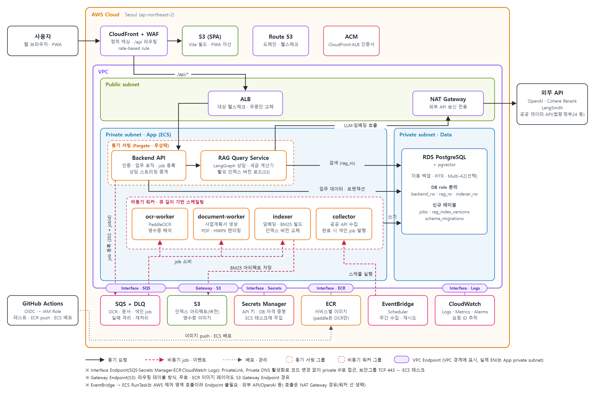

# 목표 아키텍처 (AWS)

- 작성일: 2026-10-13
- 기준 브랜치/커밋: `develop` / `37a2baf`
- 용도: 아키텍처 개선 방향 정리. 구현 전 설계안이며 현재 코드·인프라와 다름

원본: `target_architecture_aws.svg`(수정 후 PNG 재생성)

## 1. 구조

| 영역 | 구성 요소 | 역할 |
| --- | --- | --- |
| 엣지 | CloudFront + WAF, S3(SPA), Route 53, ACM | 정적 화면 캐싱, `/api/*`만 ALB로 전달, 요청량 제한, 인증서 자동 갱신 |
| Public subnet | ALB, NAT Gateway | 동기 서빙 진입점, 외부 API(OpenAI·Cohere·공공 API) 송신 전용 출구 |
| Private subnet · App | **동기 서빙**: Backend API, RAG Query Service | 무상태 Fargate 서비스. 요청량 기준 Auto Scaling |
| | **비동기 워커**: ocr-worker, document-worker, indexer, collector | SQS job 소비. 큐 길이 기준 스케일링 |
| Private subnet · Data | RDS PostgreSQL + pgvector | 업무 데이터·벡터·job 상태·인덱스 버전의 단일 원천 |
| 리전 관리형 | SQS+DLQ, S3, Secrets Manager, ECR, EventBridge Scheduler, CloudWatch | 큐, 아티팩트·이미지 저장, 비밀 주입, 이미지 저장소, 스케줄, 관측 |
| VPC Endpoint | Interface(SQS·Secrets Manager·ECR·Logs), Gateway(S3) | private subnet에서 NAT 없이 리전 서비스 접근. Private DNS로 코드 변경 없음, 큐 정책 `aws:SourceVpce`로 접근 경로 제한 가능 |

### 주요 흐름

- **상담(동기)**: 사용자 → CloudFront → ALB → Backend API → RAG Query Service → RDS 검색(`rag_ro`) + OpenAI/Cohere(NAT 경유) → NDJSON 스트리밍 응답
- **장시간 작업(비동기)**: Backend API가 `jobs` 행 생성 + SQS 메시지 발행 → `202 + jobId` 반환 → 워커 처리 후 `jobs` 갱신 → 프론트 폴링/SSE로 결과 조회. 대상: 영수증 OCR, 사업계획서 생성·렌더링, 재색인
- **수집·색인**: EventBridge Scheduler → collector(ECS RunTask) → RDS 적재 → 색인 job 발행 → indexer가 임베딩(pgvector)·BM25 아티팩트(S3) 생성 → `rag_index_versions` 활성 버전 교체 → RAG Query Service가 새 버전 로드
- **배포**: GitHub Actions → OIDC로 IAM Role 획득 → ECR push → ECS 서비스 롤링 배포. SSH 미사용

## 2. 현재 대비 변경

| 현재 | 목표 | 근거 코드·문서 |
| --- | --- | --- |
| LLM 컨테이너 1개가 상담·OCR·문서 렌더링·재색인 모두 수행 | RAG Query Service + 워커 3종 + indexer로 분리 | `LLM/src/serving/django_config/urls.py`(19개 엔드포인트), `rag_routes.py` |
| 재색인이 서빙 프로세스 안에서 임베딩·메모리 BM25 재구성 | indexer가 버전 단위로 생성, 서빙은 로드만 | `LLM/src/vectorstores/hybrid.py`, `Docs/AWS_DEPLOY_GUIDE.md` 11-1(재색인 피크) |
| LLM이 `users`·`business_profiles` 직접 조회 | Backend가 프로필을 요청 body로 전달, DB role 분리 | `LLM/src/data/postgres_repository.py:273` |
| Backend가 쿼리마다 새 연결·즉시 커밋 | 커넥션 풀 + 서비스 단위 트랜잭션 | `Backend/core/db.py:128` |
| OCR·사업계획서를 동기 HTTP로 처리(작업별 timeout 10종) | job + SQS 비동기 | `Backend/core/llm_client.py` |
| Data EC2의 Postgres + 백업 cron·SNS | RDS 자동 백업·PITR | `scripts/backup_db.sh`, `docker-compose.data.yml` |
| Elasticsearch 컨테이너(서빙 미사용) | 운영 스택에서 제거, 평가용 로컬 프로필로 한정 | `Docs/Design/ARCHITECTURE.md` 1절 |
| 영수증 이미지 DB BYTEA | S3 객체 + presigned URL | `DB/app_extras.sql:20` |
| `.env` 수동 복사, SSH 22 전체 개방 | Secrets Manager 주입, OIDC 배포 | `Docs/AWS_DEPLOY_GUIDE.md` 2·8절 |
| GitHub Actions cron 수집·6시간 헬스체크 | EventBridge Scheduler, CloudWatch 알람 | `.github/workflows/collect*.yml`, `health-check.yml` |

## 3. 채택 근거

### 3-1. 서빙(읽기)과 색인(쓰기) 분리 — indexer + 버전 아티팩트
- 문제: 재색인 시 서빙 프로세스 메모리에 기존·신규 BM25가 동시에 존재 → `LLM_MEM_LIMIT` 피크 결정 요인. 인스턴스를 늘리면 인스턴스마다 재색인 필요, 결과 불일치 가능
- 선택: indexer가 한 번 빌드해 S3에 버전 키로 저장, `rag_index_versions`로 활성 버전 지정
- 근거: 현재 "새 runtime 준비 후 교체, 실패 시 기존 유지" 로직을 그대로 재사용 가능. 서빙 측은 로드만 하므로 다중 인스턴스 일관성 확보. 버전 키로 롤백 가능
- 대안 기각: Elasticsearch 복귀는 2026-10-02 메모리 BM25 전환 결정(`Docs/reports/RAG_TROUBLESHOOTING_FIX_REPORT_20261002.md`)과 충돌. Postgres 전문 검색은 현재 토큰화(어절 + 문자 2-gram) 재현 검증 필요

### 3-2. 무상태 동기 서빙 + 비동기 워커 분리
- 문제: OCR(PaddleOCR) CPU·메모리 피크가 같은 프로세스의 상담 지연에 전파. 장시간 HTTP 요청은 타임아웃·재시도 시 중복 실행 위험
- 선택: 동기 경로는 상담만, 나머지는 job으로 전환. 워커는 작업 종류별 이미지 분리(paddle 의존성은 ocr-worker만)
- 근거: 장애·스케일·배포 단위가 작업 특성과 일치. 상담 서비스 이미지 경량화로 기동 시간 단축. 워커는 큐 길이 기준으로 0~N 조절 가능
- 단계적 도입: 초기에는 Postgres `jobs` 테이블 + `FOR UPDATE SKIP LOCKED`로 신규 인프라 없이 시작, 같은 인터페이스로 SQS 교체

### 3-3. ECS Fargate
- 근거: 기존 compose 서비스 정의를 태스크 정의로 거의 그대로 옮길 수 있음. 클러스터 노드 관리 불필요. ALB 대상 그룹 연동으로 롤링 배포·헬스체크 기반 교체 기본 제공
- 대안 기각: EKS는 현재 서비스 수(동기 2 + 워커 4) 대비 운영 부담 과다. EC2 + compose 유지는 수평 확장·무중단 배포 불가
- 주의: ocr-worker 메모리 요구가 크면 EC2 capacity provider 병행

### 3-4. SQS + DLQ
- 근거: 서버 운영 없는 관리형 큐, 가시성 타임아웃으로 워커 장애 시 자동 재전달, DLQ로 반복 실패 격리. `ApproximateNumberOfMessagesVisible` 지표로 워커 스케일링
- 대안 기각: Redis + Celery는 Redis 운영(ElastiCache 비용·장애 대응) 추가. Kafka 계열은 처리량 대비 과설계
- 전제: 재전달을 고려해 job 처리를 멱등으로 설계(`jobs.status` 조건부 갱신)

### 3-5. RDS for PostgreSQL + pgvector
- 근거: 현재 `pgvector/pgvector:pg16`과 동일 엔진이라 `pg_dump`/`pg_restore`로 이전. 자동 백업·PITR이 `scripts/backup_db.sh`·freshness 검사·SNS 설정·월 1회 복원 검증 절차를 대체. 패치·스토리지 확장 관리형
- DB role 분리(`backend_rw`·`rag_ro`·`indexer_rw`): 데이터 소유권을 권한으로 강제, LLM 계열의 업무 테이블 접근 차단
- 대안 기각: Aurora는 소규모 트래픽에서 비용 우위 불명확. 트래픽 변동이 커지면 Aurora Serverless v2 재검토
- 스키마 관리: `DB/migrations/NNN_*.sql` + `schema_migrations` 테이블로 이력 관리(ORM 미사용 결정 유지)

### 3-6. S3 (아티팩트·영수증)
- 근거: BYTEA 이미지는 DB 용량·백업 시간 증가 요인. S3 + presigned URL로 Backend 메모리 경유 제거. 인덱스 아티팩트 버전 보관소 겸용

### 3-7. CloudFront + S3 정적 배포, ALB
- 근거: SPA·PWA 정적 자산은 컴퓨팅 불필요. CloudFront 경로 패턴으로 `/api/*`만 ALB 전달 → 현재 nginx 프록시 규칙과 동일한 같은 출처 구조 유지(Frontend 소스 변경 없음). ACM으로 certbot 발급·갱신 절차 제거
- 주의: `sw.js`·`manifest`의 `Cache-Control: no-cache`(`Frontend/nginx-locations.conf:31`)를 CloudFront 캐시 정책으로 이전. 상담 스트리밍은 CloudFront 오리진 응답 타임아웃·ALB idle timeout을 최장 응답 시간 이상으로 설정

### 3-8. 보안·운영
- Secrets Manager: `.env` 수동 복사 제거, ECS 태스크 정의에서 주입, 키 회전 가능
- GitHub OIDC: 장기 SSH 키·22 포트 전체 개방 제거
- WAF rate-based rule: 공개 API 남용 시 LLM 호출 비용 직결 → 엣지에서 차단. 플랜별 사용 한도는 Backend에서 별도 적용
- EventBridge Scheduler: GitHub 예약 workflow의 60일 비활성화 위험 제거, ECS RunTask 직접 실행
- CloudWatch: 6시간 주기 외부 헬스체크·autoheal cron을 분 단위 알람과 ECS 자체 재시작으로 대체. 요청 ID를 Backend → Query Service → 워커로 전파해 로그 연결

## 4. 도입 순서

1. 경계 정리(기존 EC2 유지): 프로필 전달·DB role 분리, 서비스 간 인증, Backend 커넥션 풀·트랜잭션, 마이그레이션 이력, 비밀번호 해시 교체
2. `jobs` 테이블 + ocr-worker 분리
3. indexer 분리 + 인덱스 버전 관리 → 서빙 무상태화 완료
4. RDS·S3·Secrets Manager·OIDC 전환, Elasticsearch 운영 제거
5. ECS + ALB + SQS + CloudFront 전환, Auto Scaling, Terraform으로 구성 코드화

## 5. 비용 관점

- 제거: Data EC2(현재 고정비의 약 44%), 백업 스크립트 운영 부담
- 추가: RDS, ALB, Fargate 태스크, CloudFront·WAF, VPC Endpoint(인터페이스형은 시간당 과금)
- 유지: NAT Gateway(외부 LLM API 송신에 필요)
- 금액은 태스크 수·크기 확정 후 AWS 요금 계산기로 산정 필요. 현재 단가 기준은 `Docs/AWS_DEPLOY_GUIDE.md` 비용 절
